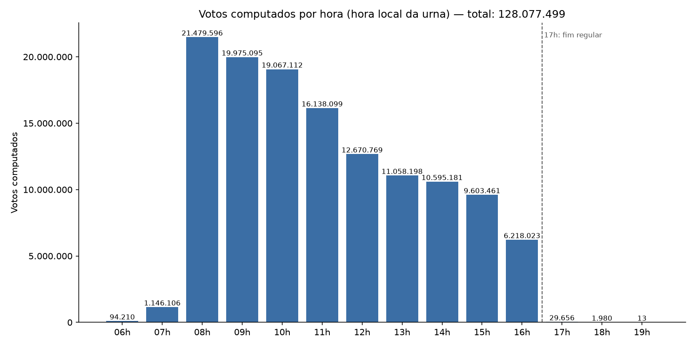

# Votos por hora e impacto da votação após as 17h

- Seções analisadas: **499.205** (falhas de download/leitura: 17.974)
- Votos computados nos logs: **128.077.499**
- Horários: relógio da própria urna (hora local da seção).

## Votos depois das 17:00

- Total após 17:00: **31.649** (0,02% do total)
- Seções com ao menos um voto após 17:00: **27.280** (5,46%)

_Nenhuma lista de municípios prorrogados foi informada (`--prorrogados`), então não há comparação._

## Votos por hora

| Hora | Total | Prorrogados | Demais |
|---|---:|---:|---:|
| 06:00-06:59 | 94.210 | 0 | 94.210 |
| 07:00-07:59 | 1.146.106 | 0 | 1.146.106 |
| 08:00-08:59 | 21.479.596 | 0 | 21.479.596 |
| 09:00-09:59 | 19.975.095 | 0 | 19.975.095 |
| 10:00-10:59 | 19.067.112 | 0 | 19.067.112 |
| 11:00-11:59 | 16.138.099 | 0 | 16.138.099 |
| 12:00-12:59 | 12.670.769 | 0 | 12.670.769 |
| 13:00-13:59 | 11.058.198 | 0 | 11.058.198 |
| 14:00-14:59 | 10.595.181 | 0 | 10.595.181 |
| 15:00-15:59 | 9.603.461 | 0 | 9.603.461 |
| 16:00-16:59 | 6.218.023 | 0 | 6.218.023 |
| 17:00-17:59 | 29.656 | 0 | 29.656 |
| 18:00-18:59 | 1.980 | 0 | 1.980 |
| 19:00-19:59 | 13 | 0 | 13 |

